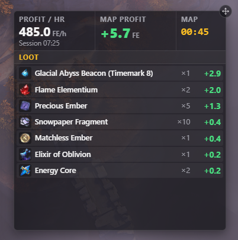
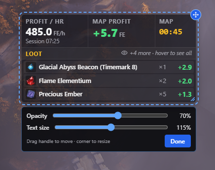
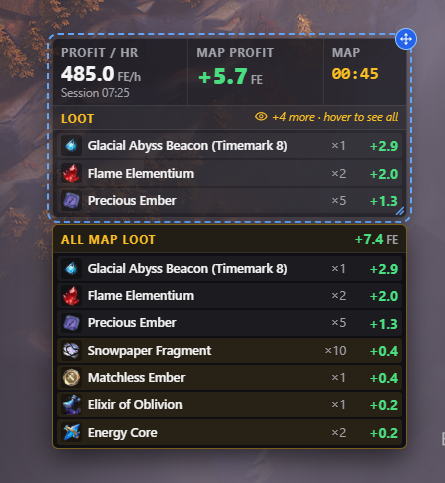

# Compact Window

One small, click-through window with profit per hour, the current map's profit and timer, and the map's loot.

## What it shows

- **Profit / hr** for the session, with the session time under it.
- **Map profit**: starts at minus the map's cost (map activation plus consumables) when a map begins, and rises with every drop. Red below zero, green above.
- **Map**: the map timer.
- **Loot**: the current map's drops, most valuable first, with quantity and value. Before the first drop it shows "Waiting for drops…" and how much FE is needed to break even, when there is room for it.

## Using it

- **Turn it on or off:** press F8 and tick **Compact Window** under Active Modules.
- **Click-through:** clicks pass through the window to the game. The only clickable part is the small round handle on the top-right corner.
- **Move:** drag the handle.
- **Configure:** click the handle. The window gets a dashed outline, a resize grip in the bottom-right corner, and a panel with **Opacity** (30–100%, background only) and **Text size** (80–150%). Click **Done** or the handle again to finish.
- **Resize:** only the loot list grows or shrinks; the top row always stays. A narrow window shrinks the numbers to fit.

## Full loot list on hover

When not all items fit, the Loot bar shows an eye icon with `+N more · hover to see all` (or `N items · hover to see all` when the window is too small for any rows). Hovering it opens the full list next to the window, without making the window catch clicks. Items hidden in the window are highlighted.

The list opens below the window if it fits, otherwise above, otherwise beside it (towards the middle of the screen), and always stays inside the screen. It stays open while the cursor is over the hint, the window or the list.

## Settings saved

Position, size, opacity and text size are kept between runs (`compactWindow`, `compactWindowOpacity` and `compactWindowFontScale` in the tracker's saved settings).

## Code

- `src/components/CompactWindow.vue`: the window, configure mode and hover list.
- `src/stores/trackerStore.ts`: saved settings.
- `src/components/BuilderPanel.vue`: the F8 menu checkbox.
- `src/App.vue`: mounts the window.
