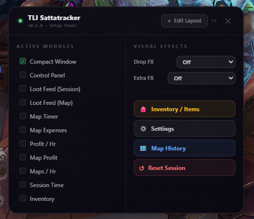
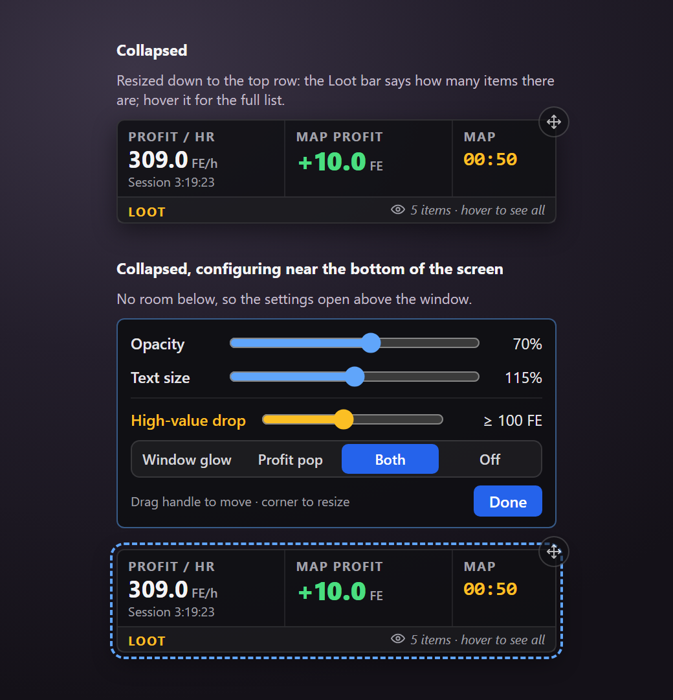
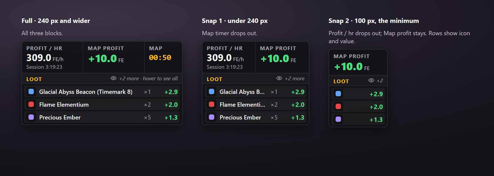
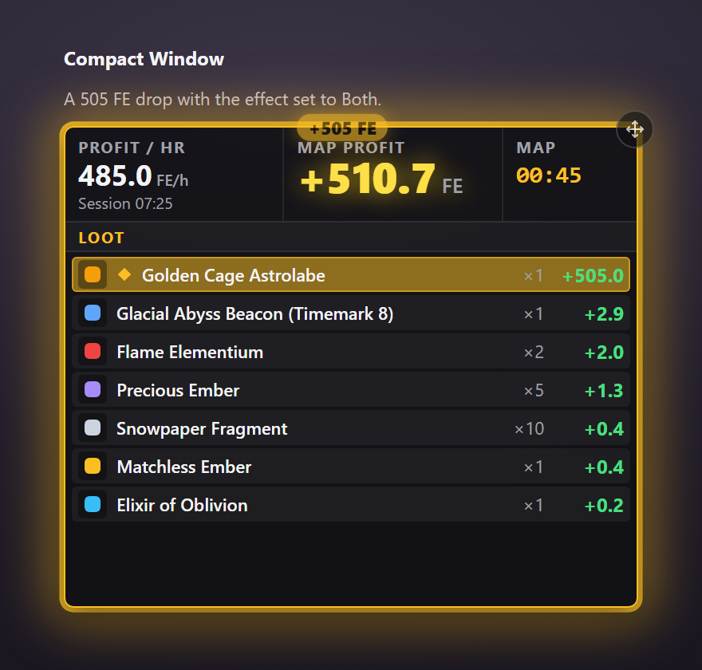

# Compact Window

One small, click-through window with profit per hour, the current map's profit and timer, and the map's loot.

Images on this page are rendered from the design, except the F8 panel and the hover list, which are in-game screenshots.

## What it shows

- **Profit / hr** for the session, with the session time under it.
- **Map profit**: starts at minus the map's cost (map activation plus consumables) when a map begins, and rises with every drop. Red below zero, green above.
- **Map**: the map timer.
- **Loot**: the current map's drops, most valuable first, with quantity and value.
- **Big numbers** stay short so they fit: one decimal below 1000 FE (`+431.5`), whole numbers from 1000 (`+9877`), then `k` from 100,000 and `M` from a million. A profit/hr in the first seconds of a session can reach millions, so it shows as `3.6M`. Before the first drop it shows "Waiting for drops…" and how much FE is needed to break even, when there is room for it.

## Using it

**Turn it on or off:** press F8 and tick **Compact Window** under Active Modules.

- **Click-through:** clicks pass through the window to the game. The only clickable part is the small round handle on the top-right corner.
- **Move:** drag the handle.
- **Configure:** click the handle. The window gets a dashed outline, a resize grip in the bottom-right corner, and a panel with **Opacity** (30–100%, background only) and **Text size** (80–150%). It also has the **High-value drop** settings (see below). The panel opens below the window, or above it when the window sits too low on the screen for it to fit. Click **Done** or the handle again to finish.
- **Resize height:** only the loot list grows or shrinks; the top row always stays. The edge snaps to "top row only" and "top row plus the Loot bar".
- **Resize width:** narrowing the window drops the top-row blocks one at a time, each with a snap point: first the **Map** timer, then **Profit / hr**. **Map profit** always stays; its width is the narrowest the window goes. In the narrowest layout the loot rows show only icon and value, and the Loot bar shows just the count.

Shrunk down to the top row and the Loot bar, the window keeps only the numbers; the Loot bar says how many items there are and the full list is a hover away.

Narrowing it drops the top-row blocks one at a time:

## Full loot list on hover

When not all items fit, the Loot bar shows an eye icon with `+N more · hover to see all` (or `N items · hover to see all` when the window is too small for any rows). Narrower windows drop the `· hover to see all` part, and the narrowest shows only the number. Hovering it opens the full list next to the window, without making the window catch clicks. Items hidden in the window are highlighted.

The list opens below the window if it fits, otherwise above, otherwise beside it (towards the middle of the screen), and always stays inside the screen. It stays open while the cursor is over the hint, the window or the list.

## High-value drop

A drop worth at least the **High-value drop** amount (100 FE by default, after tax if tax is on; a drop's worth is price × quantity) is marked with a gold diamond and a gold row for the rest of the map, and plays the chosen effect once:

- **Window glow:** the window's border flashes gold.
- **Profit pop:** Map profit pops and glows gold, and a `+N FE` tag floats up over it.
- **Both** (default): border flash and profit pop together.
- **Off:** no effect; the row is still marked.

The amount is a slider with steps: Off, 10, 20, 50, 100, 200, 500, 1000, 2000 and 5000 FE. It's a slider rather than a text field because the overlay never takes keyboard focus from the game. **Off** turns the marking off as well.

## Settings saved

Position, size, opacity, text size and the high-value drop settings are kept between runs (`compactWindow`, `compactWindowOpacity`, `compactWindowFontScale`, `compactHighValueThreshold` and `compactHighValueEffect` in the tracker's saved settings).

## Code

- `src/components/CompactWindow.vue`: the window, configure mode, hover list, width snap points and high-value drop effects.
- `src/stores/trackerStore.ts`: saved settings.
- `src/components/BuilderPanel.vue`: the F8 menu checkbox.
- `src/App.vue`: mounts the window.
