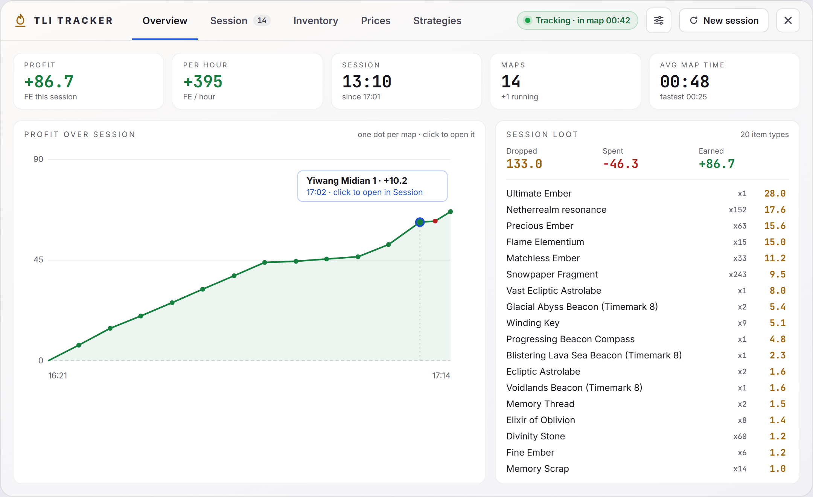
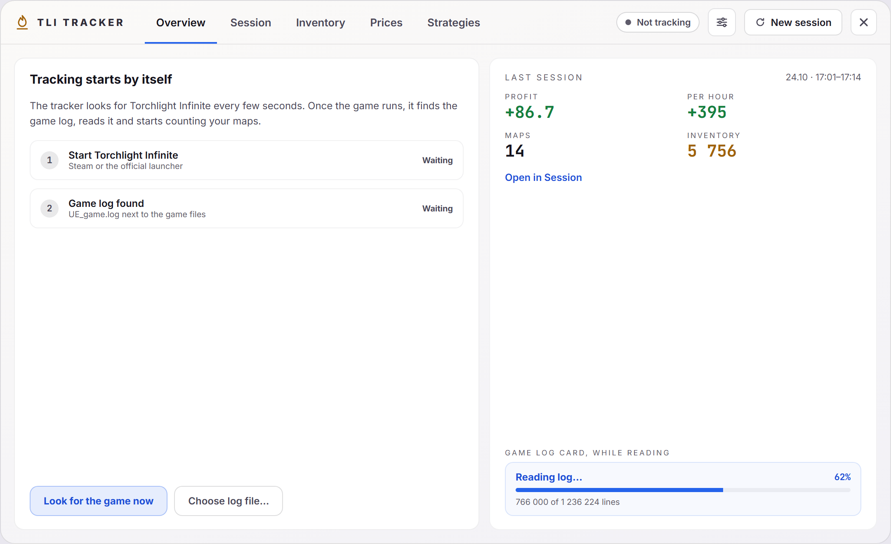
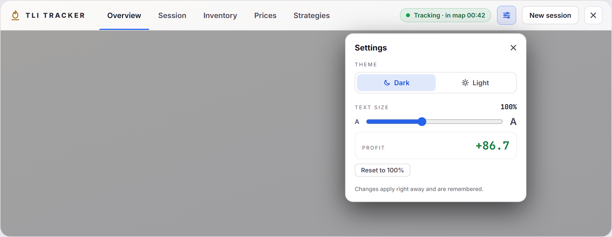
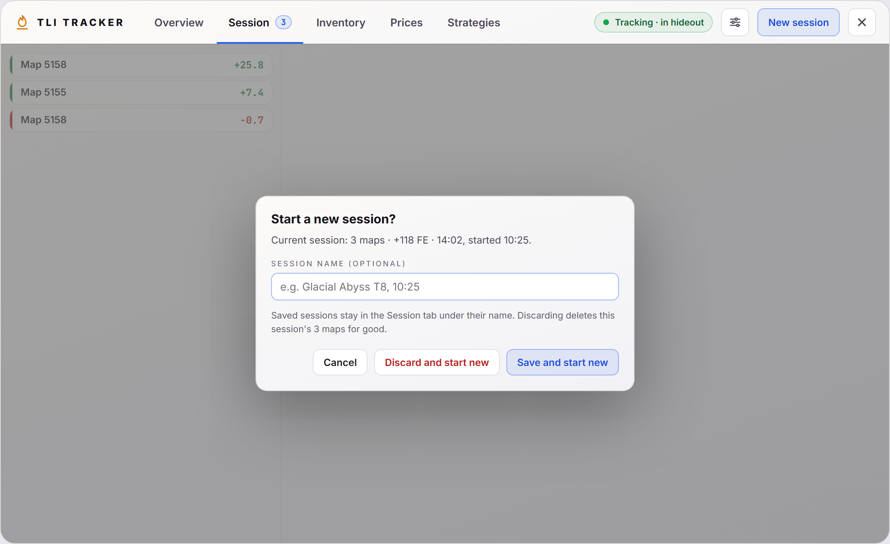

# Dashboard

One window with tabs (Overview, Session, Inventory, Prices and Strategies) for the current session, past sessions, your bag, market prices and the community's best farming strategies.

## Pages

- [Overview](dashboard-ui/overview.md): profit, pace and loot of the current session at a glance.
- [Session](dashboard-ui/session.md): every map of the current, a saved or all sessions, and cleanup of saved sessions.
- [Inventory](dashboard-ui/inventory.md): search your bag and see what it is worth.
- [Prices](dashboard-ui/prices.md): every known price, grouped by item type.
- [Strategies](dashboard-ui/strategies.md): the community strategy ladder with filters, costs, loot and talent trees, plus your favorite strategies with notes.

The images in these pages are rendered from the dashboard design with sample data, so numbers and names differ from a real session.

## Opening it

- **F6** opens and closes the dashboard, also while the game has focus. **Esc** or the **×** button closes it.
- While it is open, the overlay catches clicks; when it closes, clicks pass through to the game again.

## Header

- **Tabs** with the number of maps of the current session on Session.
- **Status:** `Tracking · in map 01:23` during a map, `Tracking · in hideout` between maps, or `Not tracking · game log not found` when the tracker cannot find the game log (checked each time the window opens).

## Settings

The sliders button opens the settings panel:

- **Theme:** dark or light.
- **Text size:** 80–130%. It scales the whole window, so text and spacing grow together. **Reset to 100%** goes back to the default.

Changes apply right away and are kept between runs (`dashboardTheme` and `dashboardFontScale` in the tracker's saved settings).

## New session

**New session** shows the current session's maps, profit and time, with an optional name field (up to 60 characters), then:

- **Save and start new** (or Enter in the name field) saves the session, under its name if you gave one, and starts a new one. Saved sessions stay available in the [Session](dashboard-ui/session.md) tab.
- **Discard and start new** deletes the session and its maps and starts a new one. It asks once more (`Delete N maps?`) before deleting.
- **Cancel** keeps the current session.

## Code

- `src/components/dashboard/DashboardWindow.vue`: the window, header, settings panel, New session and the light and dark theme colours.
- `src/components/dashboard/categories.ts`: bag tabs and the main types for prices.
- `src/components/dashboard/format.ts`: number and time formatting.
- `src/App.vue`: mounts the window and opens it on F6.
- `src/stores/trackerStore.ts`: saved theme and text size, saving, discarding and deleting sessions.
- `src-tauri/src/lib.rs`: the F6 shortcut, item types in `get_all_prices`, the `get_price_status` command and the strategy commands.

Each page lists the files behind its tab.
