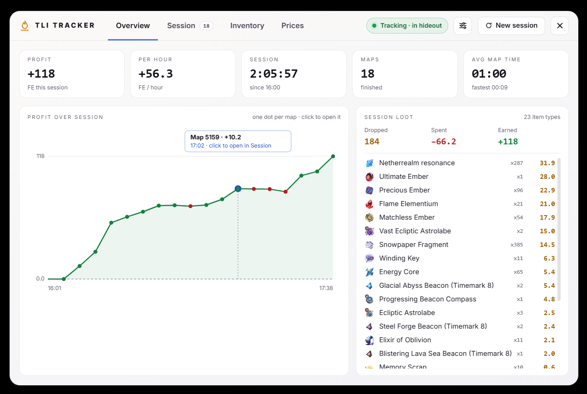
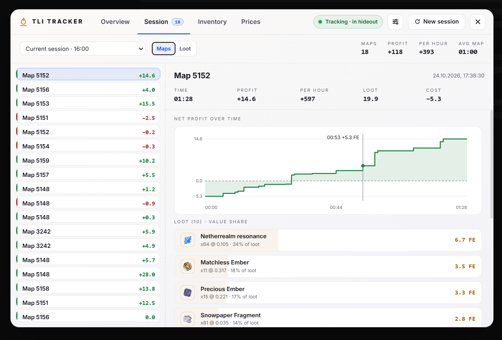
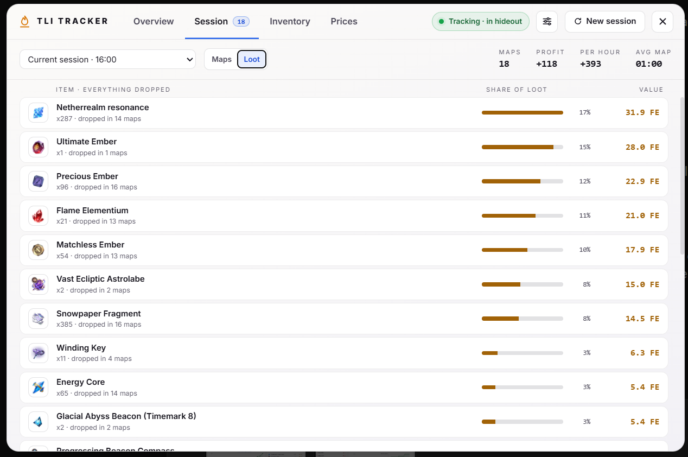
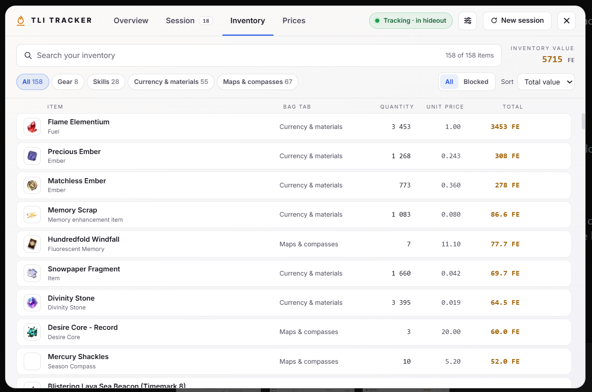
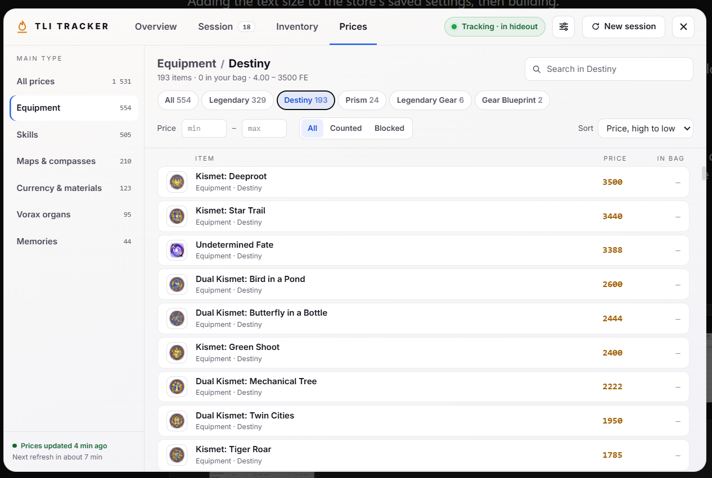
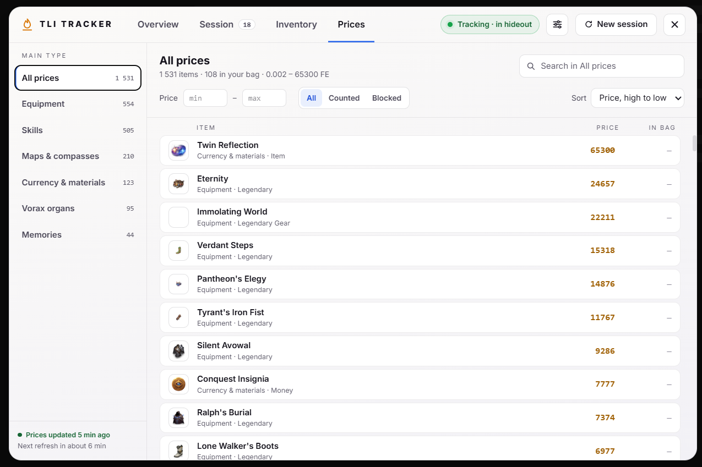

# Dashboard

One window with four tabs (Overview, Session, Inventory and Prices) for the current session, past sessions, your bag and market prices.

## Opening it

- **F6** opens and closes the dashboard, also while the game has focus. **Esc** or the **×** button closes it.
- While it is open, the overlay catches clicks; when it closes, clicks pass through to the game again.

## Header

- **Status:** `Tracking · in map 01:23` during a map, `Tracking · in hideout` between maps, or `Not tracking · game log not found` when the tracker cannot find the game log (checked each time the window opens).
- **Settings** (sliders button):
  - **Theme:** dark or light.
  - **Text size:** 80–130%. It scales the whole window, so text and spacing grow together.
- **New session:** shows the current session's maps, profit and time, with an optional name field (up to 60 characters), then:
  - **Save and start new** (or Enter in the name field) saves the session, under its name if you gave one, and starts a new one. Saved sessions stay available in the Session tab.
  - **Discard and start new** deletes the session and its maps and starts a new one. It asks once more (`Delete N maps?`) before deleting.
  - **Cancel** keeps the current session.

## Overview

- **Profit**, **Per hour**, **Session** time (with its start time), **Maps** finished (`+1 running` while you are in a map) and **Avg map time** (with the fastest map).
- **Profit over session:** the session's running total, one dot per map. Green dots are profitable maps, red dots lost FE, the blue dot is the map you are in. Hovering a dot shows the map, its profit and start time; clicking it opens that map in the Session tab.
- **Session loot:** **Dropped** (value of everything picked up), **Spent** (map costs and consumables) and **Earned** (the session profit), then every item dropped this session, most valuable first. The list scrolls.

## Session

Choose what to look at in the dropdown: **Current session**, **All time**, or a saved session (`name · date time · maps · profit`, without the name when none was given). Sessions are saved when you start a new one. The right side shows the number of maps, profit, profit per hour and average map time for the selection.

**Maps** lists the maps, newest first, with a green or red edge for profit or loss and `LIVE` on the running map. Selecting one shows its time, profit, per hour, loot value and cost, the net profit over time, its loot with each item's share of the map's value, and its expenses.

**Loot** combines everything dropped in the selection: quantity, in how many maps it dropped, its share of all loot and its value.

## Inventory

Search through your bag and see what everything is worth.

- **Search** matches item names and types; the count shows how many items match.
- **Bag tab** chips follow the game's own bag tabs: Gear, Skills, Currency & materials, Maps & compasses.
- **All / Blocked**, and **Sort** by total value, unit price, quantity or name.
- Each row shows the item's type, bag tab, quantity, unit price and total. Hover a row to **Block** or **Unblock** it; blocked items are left out of the inventory value shown here. Blocking is the same list as in the old Inventory window and does not change loot or profit.

The list comes from the tracker's last reading of your bag, which happens when you sort your bag in game. Until then the tab says there is no inventory data yet.

## Prices

Every price the tracker knows, grouped by item type.

- **Main type** (left): Equipment, Skills, Maps & compasses, Currency & materials, Vorax organs and Memories, with item counts.
- **Sub type** chips: the item types inside the chosen main type, for example Legendary, Destiny and Prism under Equipment, or Noble and Magnificent support skills under Skills.
- **Search** within the selection, **Price** min and max, **All / Counted / Blocked**, and **Sort** by price or name.
- **In bag** shows how many of the item you have. Items you own have a highlighted border.
- Bottom left: when the prices were last updated and when the next refresh is due (every 10 minutes while the tracker runs). Before the first download it says the tracker is using saved prices.

Main and sub types come from the item table bundled with the tracker (`src-tauri/data/en_id_table.json`). Types that are not listed under another main type fall under Currency & materials.

## Settings saved

Theme and text size are kept between runs (`dashboardTheme` and `dashboardFontScale` in the tracker's saved settings).

## Code

- `src/components/dashboard/DashboardWindow.vue`: the window, header, settings panel, New session and the light and dark theme colours.
- `src/components/dashboard/OverviewTab.vue`, `SessionTab.vue`, `InventoryTab.vue`, `PricesTab.vue`: the tabs.
- `src/components/dashboard/categories.ts`: bag tabs and the main types for prices.
- `src/components/dashboard/format.ts`: number and time formatting.
- `src/App.vue`: mounts the window and opens it on F6.
- `src/stores/trackerStore.ts`: saved theme and text size.
- `src-tauri/src/lib.rs`: the F6 shortcut, item types in `get_all_prices` and the new `get_price_status` command.
- `src-tauri/src/db.rs`: item types from the item table, with untranslated and malformed types cleaned up.
- `src-tauri/src/bag_manager.rs`, `tailer.rs`: the bag tab and type of each inventory item.
- `src-tauri/src/pricing.rs`: the time of the last successful price refresh.
