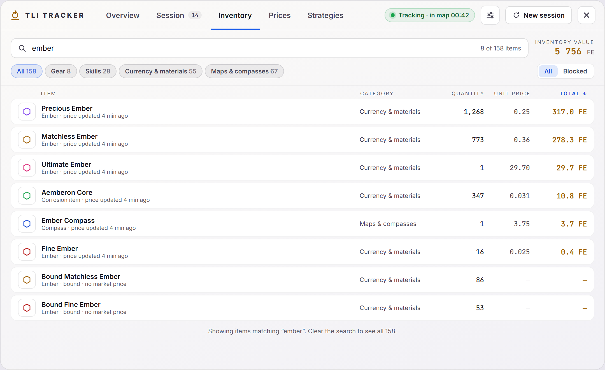

# Inventory

Search through your bag and see what everything is worth. Part of the [Dashboard](../dashboard-ui.md).

- **Search** matches item names and types; the count shows how many items match.
- **Bag tab** chips follow the game's own bag tabs: Gear, Skills, Currency & materials, Maps & compasses.
- **All / Blocked**.
- **Sort** by clicking a column header: Item, Bag tab, Quantity, Unit price or Total. Click again to reverse. Items without a value stay last either way, and the tab remembers your choice.
- Each row shows the item's type, bag tab, quantity, unit price and total. Hover a row to **Block** or **Unblock** it; blocked items are left out of the inventory value shown here. Blocking is the same list as in the old Inventory window and does not change loot or profit.

The list comes from the tracker's last reading of your bag, which happens when you sort your bag in game. Until then the tab says there is no inventory data yet.

## Code

- `src/components/dashboard/InventoryTab.vue`
- `src-tauri/src/bag_manager.rs`, `tailer.rs`: the bag tab and type of each inventory item.
- `src-tauri/src/db.rs`: item types from the item table, with untranslated and malformed types cleaned up.
