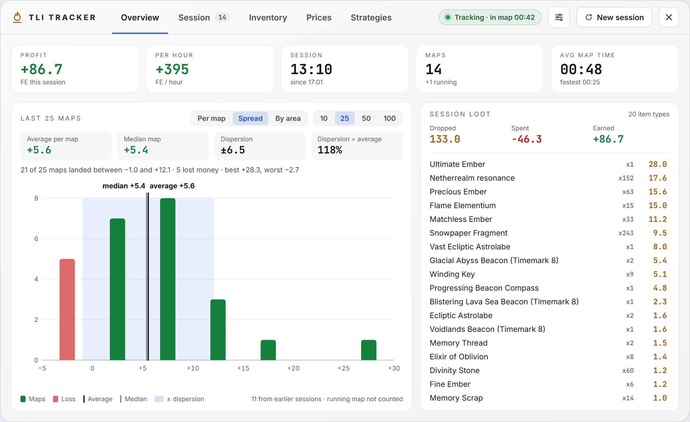
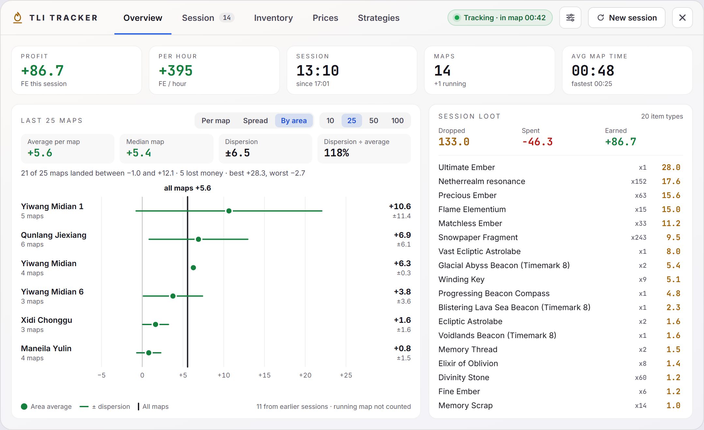

# Overview

The current session at a glance. Part of the [Dashboard](../dashboard-ui.md).

## Numbers

- **Profit:** FE earned this session.
- **Per hour:** profit per hour of session time.
- **Session:** session time, with the time it started.
- **Maps:** maps finished, with `+1 running` while you are in a map.
- **Avg map time:** with the fastest map of the session.

## Profit per map

Shows how much the last maps earn and how much they swing, instead of the session's running total, which only climbs. Pick **10**, **25**, **50** or **100** maps. The choice and the view are remembered.

The list can reach into earlier sessions; the note at the bottom says how many of the maps are from them. The running map isn't counted, because its profit still changes. It needs at least 2 finished maps.

Four numbers are above the chart:

- **Average per map:** total profit divided by the number of maps.
- **Median map:** half of the maps earned more, half earned less. Lucky drops barely move it, so a median well below the average means a few drops carry the profit.
- **Dispersion:** the standard deviation, how far a map usually lands from the average.
- **Dispersion ÷ average:** lower is steadier. Above 100%, a map can swing by more than it earns on average.

A line below them gives how many maps landed within one dispersion of the average, how many lost money, and the best and worst map.

### Per map

One column per map, oldest on the left. Losses go below zero. The black line is the average and the blue band is the average ± dispersion. A vertical line marks where the current session starts. Hovering a column shows the map, its profit and start time; clicking it opens that map in Session, in its saved session if it's from an earlier one.

### Spread

How many maps fell in each profit range, with the average and median marked. Hover a column for its range and share of the maps.

### By area

Average profit and dispersion per area, best average first, so you can see which areas pay and which are steady. The dot is the area's average and the line its average ± dispersion, with the numbers on the right. The black line is the average of all maps. An area with one map has no dispersion and says `one map`. Areas show as `Map` and their level id, as in the Session tab. With many areas the list scrolls.

## Session loot

- **Dropped:** value of everything picked up.
- **Spent:** map costs and consumables.
- **Earned:** the session profit.

Below them, every item dropped this session with its quantity and value, most valuable first. The list scrolls.

## Code

- `src/components/dashboard/OverviewTab.vue`
- `src/components/dashboard/MapSpreadPanel.vue`
- `src/components/dashboard/mapStats.ts`
