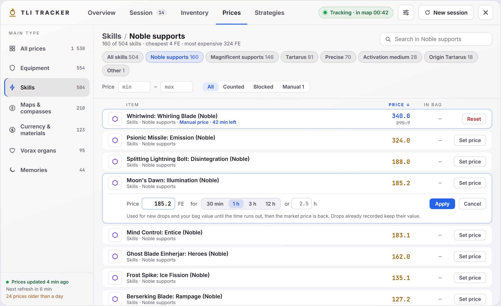

# Prices

Every price the tracker knows, grouped by item type. Part of the [Dashboard](../dashboard-ui.md).

- **Main type** (left): Equipment, Skills, Maps & compasses, Currency & materials, Vorax organs and Memories, with item counts.
- **Sub type** chips: the item types inside the chosen main type, for example Legendary, Destiny and Prism under Equipment, or Noble and Magnificent support skills under Skills.
- **Search** within the selection, **Price** min and max, and **All / Counted / Blocked / Manual**.
- **Sort** by clicking a column header: Item, Price or In bag. Click again to reverse; the tab remembers your choice.
- **In bag** shows how many of the item you have. Items you own have a highlighted border.
- Bottom left: when the prices were last updated and when the next refresh is due (every 10 minutes while the tracker runs). Before the first download it says the tracker is using saved prices.

## Manual prices

When a market price is wrong for you, for example right after a patch or for an item you sell privately, you can set your own price for a limited time.

- **Set price** on an item's row opens a small editor: the price in FE and how long it lasts (**30 min**, **1 h**, **3 h**, **12 h**, or your own number of hours, up to 7 days). Press **Apply** or Enter; **Cancel** or Esc closes it.
- The row then shows the manual price in blue with the market price crossed out under it, and the time left (`Manual price · 42 min left`). The **Manual** filter lists every item that has one.
- **Reset** goes back to the market price right away. When the time runs out, it goes back by itself.

While it's running, the manual price replaces the market price wherever the tracker values the item:

- **New drops** and map costs use it, and so does your **bag value** the next time it's calculated. Drops already recorded keep the value they had, so finished maps and session history don't change.
- A price refresh or an auction price you look up in the game doesn't replace it.
- The Strategies tab's "at today's prices" numbers use it too.
- Manual prices are saved with their end time, so they survive a restart; one that ended while the tracker was closed is simply gone. Flame Elementium (FE) itself can't be changed, and a blocked item stays worth 0.

Main and sub types come from the item table bundled with the tracker (`src-tauri/data/en_id_table.json`). Types that are not listed under another main type fall under Currency & materials.

## Code

- `src/components/dashboard/PricesTab.vue`
- `src/components/dashboard/categories.ts`: the main types and which item types belong to them.
- `src-tauri/src/pricing.rs`: the time of the last successful price refresh, and manual prices (saved in `price_overrides.json` in the app data folder).
