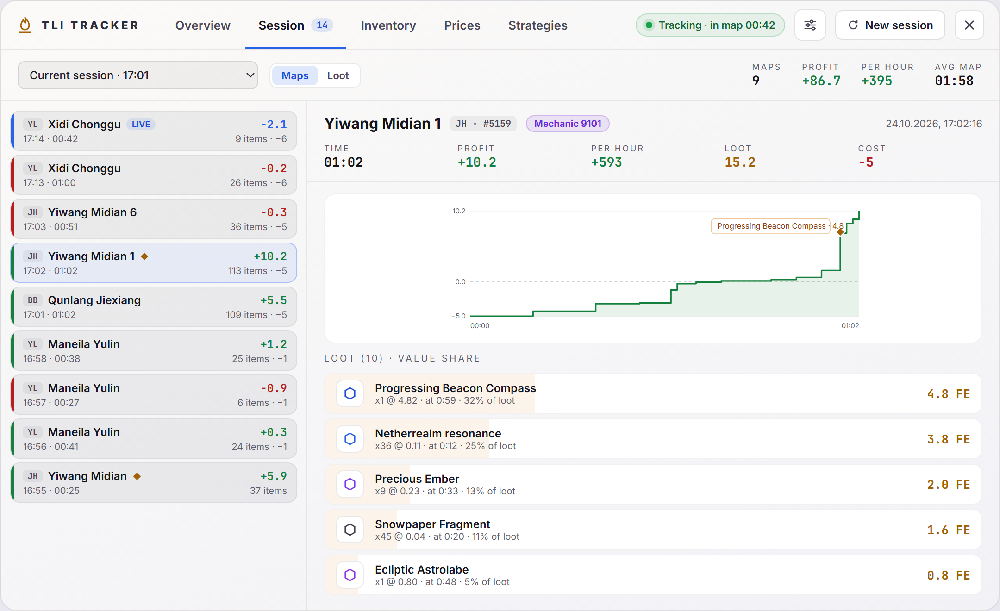
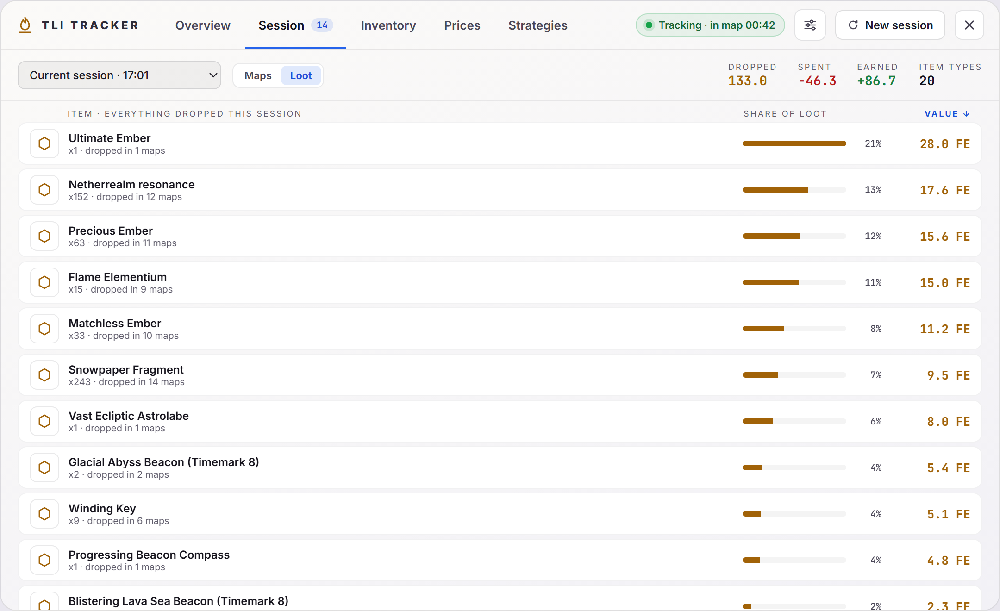
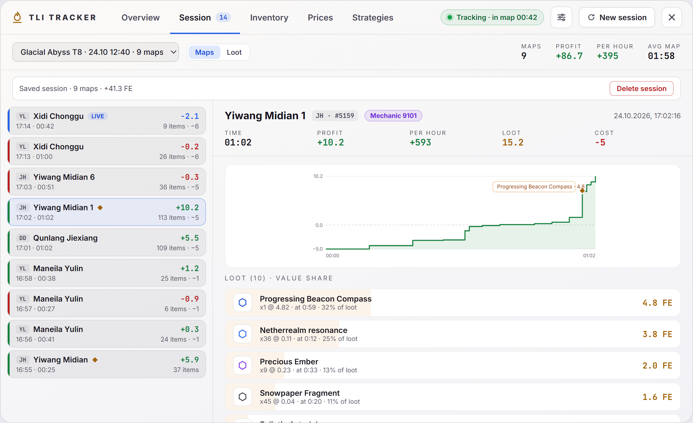
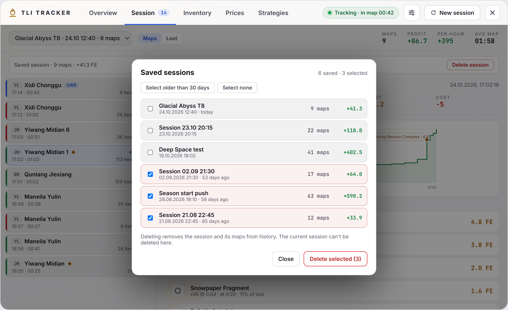

# Session

Every map of the current session, a saved session or all of them. Part of the [Dashboard](../dashboard-ui.md).

## Choosing a session

The dropdown offers:

- **Current session**, with its start time.
- **All time**: every recorded map.
- **Saved sessions**, as `name · date time · maps · profit` (without the name when none was given). A session is saved when you start a new one with **Save and start new**.
- **Manage saved sessions…** (see [Cleaning up](#cleaning-up-saved-sessions)).

The right side of the toolbar shows the number of maps, profit, profit per hour and average map time for the selection.

## Maps

The maps of the selection, newest first. Each row has a green or red edge for profit or loss (blue for the running map, marked `LIVE`), the map's start time and duration, item count and cost.

Selecting a map shows:

- **Time**, **Profit** (green or red), **Loot** value (gold) and **Cost** (red when the map cost something).
- The map's net profit over time; hover the chart to read it at any moment. The running map is marked `IN PROGRESS`.
- **Expenses:** what the map consumed, with quantity, price per item and FE.
- **Loot:** what dropped, with each item's share of the map's value.

Expenses and Loot collapse from their headers, which also show their totals. The tab remembers which ones you closed.

### Changing a price for one map

The pencil on an expense or loot row of a finished map sets your own price per item, **for that map only**: for example when a drop sold for less than its market price. Press **Apply** or Enter; **Cancel** or Esc closes the editor.

- The row shows the new price in blue with `edited, was 4.82`, and a **Revert** button brings the recorded price back. A strip above the lists shows how many prices are edited, with **Revert all**. The map's row in the list says `edited`.
- The map's **Profit**, **Loot** and **Cost**, and the session's totals and Loot view, follow the edit. The item's price anywhere else doesn't change. For a price that applies everywhere for a limited time, use [manual prices](prices.md#manual-prices).
- The chart keeps the prices recorded during the run, because it stores only the running total.
- The running map can't be edited yet: its values change with every drop. Edit it once it has ended.
- With **Apply market tax** on, recorded drop prices are after tax, so enter yours after tax too; the editor reminds you. Expenses aren't taxed.
- Each map stores its 80 most valuable drops, so very cheap items beyond that have no row to edit.
- Edits are saved with the map and go away when the map or session is deleted.

## Loot

Everything dropped in the selection combined: quantity, in how many maps it dropped, its share of all loot and its value. Click a column header (Item, Share of loot, Value) to sort; click again to reverse.

## Deleting a saved session

With a saved session selected, a strip under the toolbar shows `Saved session · N maps · profit FE` and **Delete session**. The first click turns the button red (`Delete N maps?`); the second deletes the session and its maps and switches back to the current session. Clicking elsewhere or choosing another session cancels.

## Cleaning up saved sessions

**Manage saved sessions…** at the end of the dropdown opens a list of all saved sessions with their date, age, maps and profit.

- Tick the sessions to delete, or use **Select older than 30 days** and **Select none**.
- **Delete selected (N)** asks once more (`Delete N sessions?`) and then removes those sessions and their maps from history.
- The current session is never in this list and can't be deleted here.

## Code

- `src/components/dashboard/SessionTab.vue`, `MapItemRow.vue`: the tab, and a map's loot and expense rows with the price editor.
- `src/stores/trackerStore.ts`: `deleteSessions` removes sessions and their maps (maps belong to a session by `sessionId`); `setMapItemPrice` sets or reverts a price for one map.
