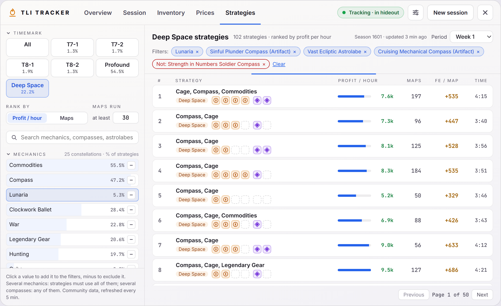
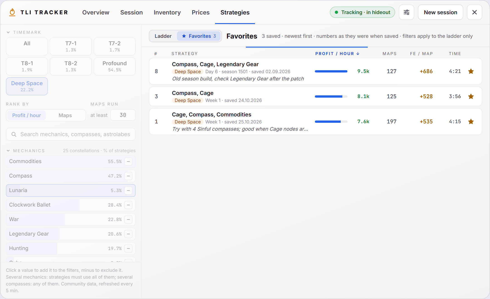
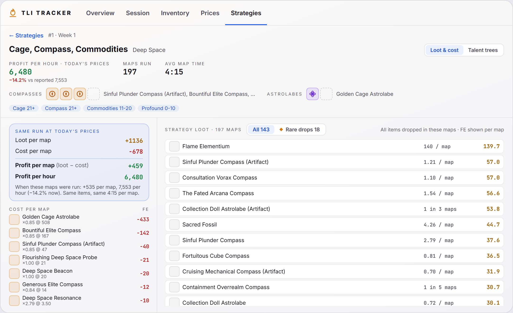
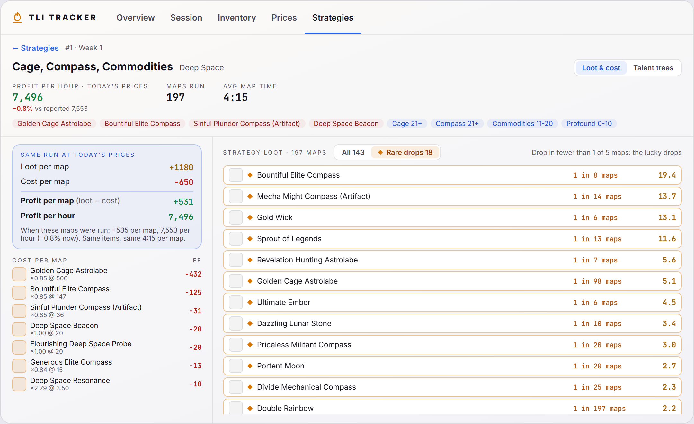
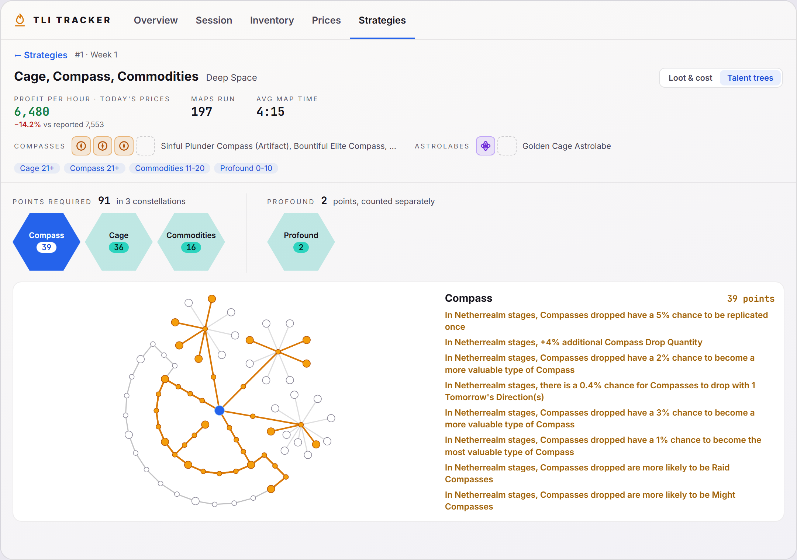

# Strategies

The community's best farming strategies for the season, with what they cost, what they drop and which talents they use. Part of the [Dashboard](../dashboard-ui.md).

The data comes from the community strategy ladder: players' trackers upload their maps, grouped into strategies by timemark, area, talents and the compasses and astrolabes they use. Only strategies with enough maps this period are listed (up to 500).

## Filters (left)

Every section collapses from its header; a collapsed section still shows what is picked. The tab remembers which sections you closed.

- **Timemark:** All, T7-1, T7-2, T8-1, T8-2, Profound or Deep Space, with each one's share of the reported maps.
- **Rank by:** profit per hour or maps run.
- **Maps run:** only strategies with at least this many maps (30 by default).
- **Search:** narrows the lists below.
- **Mechanics:** the talent constellations (Profound left out), with the share of strategies that put points into each.
- **Compasses** and **Astrolabes:** the items strategies use, with icons and shares.

Click a value to add it to the filters, click it again to remove it; the minus button excludes it instead (strategies using it are hidden, shown as `Not: …`). With several mechanics, a strategy must use all of them; with several compasses or astrolabes, any of them.

## The list

- The heading names the timemark and how many strategies match, with the period on the right. Active filters show as chips under it and wrap onto more lines when needed; **Clear** removes them all.
- Each row: the strategy's constellations, its area, profit per hour with a bar, maps run, FE per map and average map time.
- 10 strategies per page, one request per page. A line under the filters runs while results load. The compasses and astrolabes a strategy uses are shown in its detail, so the list doesn't need a request per row.
- If loading fails (the server is busy, rate limiting or unreachable), a notice says what couldn't load and why, the list keeps the previous results, the tab tries once more after a few seconds and offers **Retry**.
- The star at the end of a row saves the strategy to your favorites (see below).

## Coming back to the tab

The tab keeps where you were. Closing the dashboard (F6) or switching to another tab and back shows the same filters, page and open strategy, without loading the list again; results older than 5 minutes are refreshed.

The filters, search, page, period, the open strategy and its view (Loot & cost or Talent trees) are also saved on your computer, so they come back after the tracker restarts. A period the server no longer offers falls back to the newest week.

## Favorites

- **Save a strategy:** click the star on its row, or **Save to favorites** in its detail. Click again (**In favorites**) to remove it. A favorite belongs to the period it was saved from: the same strategy in another week is starred separately, with its own note.
- **Note:** a saved strategy's detail has a **Your note** box under the header, for why you saved it, what to try or how it went (up to 500 characters). It's saved as you type.
- **Favorites list:** the **Ladder / Favorites** switch at the top of the list shows your saved strategies, newest first, with your note, the period they're from and when you saved them. The numbers are the ones the strategy had when you saved it. The filters on the left apply to the ladder only and are dimmed while favorites are shown.
- Click a favorite to open its detail for the period it was saved from. If the server no longer has that strategy (an older period or season), the detail says so; the note and the saved numbers stay.
- Favorites are kept on your computer across seasons, up to 200; when the list is full, remove one before saving another.

## Strategy detail

Click a strategy to open it. The header shows:

- **Profit per hour at today's prices**, with the change against the rate reported when the maps were run, then maps run and average map time.
- **Compasses** (up to 4 slots) and **Astrolabes** (up to 2): the ones used in at least half of the strategy's maps, most used first, with their icons and names. Unused slots stay empty; hover a slot for the item's name.
- Its talent point ranges per constellation.
- **Save to favorites** next to the title, and your note when the strategy is saved.

### Loot & cost

- **Same run at today's prices:** loot per map, cost per map, profit per map (loot − cost) and profit per hour, valued at the prices the tracker has now, next to what the strategy reported back then.
- **Cost per map:** each item used, how many per map, its price and FE.
- **Strategy loot:** every item dropped in the strategy's maps, shown per map: how often it drops (`1 in 98 maps`, `2.3 / map`) and its FE per map. **Rare drops** lists the lucky ones only: items found in fewer than one of five maps that are still worth something.

The data has totals per strategy, not single maps, so the loot can't be split by map.

### Talent trees

- **Points required:** the points the strategy spends across its constellations, with a tile per constellation it uses. Profound is counted separately.
- Click a tile to draw that constellation: taken nodes and links in gold, the start in blue, and each node's effect on hover. Next to it, the medium and large node effects, then small nodes as `×N`.
- The data counts talents per effect, not per node. Medium and large nodes are therefore exact; small nodes are placed on the shortest path from the start. A node whose spot is a guess (the same effect sits on several nodes and only some were taken) has a dashed outline.
- Profound: the community data records almost no large Profound nodes (9 of 11 never appear in any strategy), so Profound usually shows fewer points than players spent.

## Data and privacy

- Requests go through the tracker's back end to the strategy server's read-only endpoints. Answers are kept for 5 minutes (strategy details for 30), and saved answers up to 2 hours old are shown when the server fails. The saved answers take at most 32 MB and 300 entries; the oldest go first.
- Player names and IDs are removed from every answer before it reaches the window.
- There are two strategy servers. The tracker asks the one that answered last first, and moves on to the other when a server fails or sends a web page (a bot check) instead of data.
- Every request is written to the tracker's log, `%LOCALAPPDATA%\com.fedin.sattatracker\logs\tracker.log`: from cache or from which server, the HTTP status, the time it took, and the reason when it failed. The log rolls over at 1 MB and keeps two older files (`tracker.1.log`, `tracker.2.log`).
- English names for talents, constellations, areas and timemarks are bundled with the tracker; constellation layouts too (about 90 KB).

## Code

- `src/components/dashboard/StrategiesTab.vue`: filters, list, paging and the favorites list.
- `src/components/dashboard/strategies/state.ts`: the tab's state, kept while the dashboard is closed and saved between runs (`tli_strategies_state` in local storage).
- `src/components/dashboard/strategies/favorites.ts`: saved strategies and notes (`tli_strategy_favorites`).
- `src/components/dashboard/StrategyDetail.vue`: the detail view.
- `src/components/dashboard/TalentTrees.vue`: constellation tiles and tree drawing.
- `src/components/dashboard/strategies/api.ts`: requests, caching of details and English labels.
- `src/components/dashboard/strategies/trees.ts`, `trees.json`, `talents.json`: constellation layouts, point placement and talent texts.
- `src-tauri/src/strategy.rs`: the proxy to the strategy server, its cache and the `get_item_info` command.
